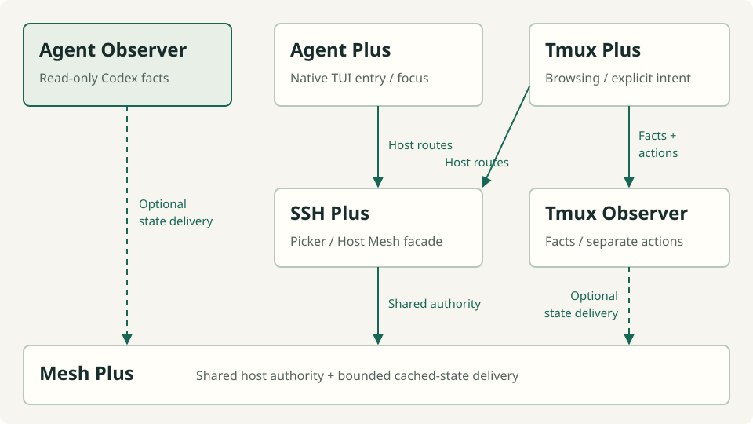

# How the projects fit together

Native Codex and Claude managers own their conversations and work. Fleet Plus's
projects supply observation, host access and independent desktop conveniences.

*Arrows show interface use; dashed arrows are optional delivery. This diagram
describes project relationships. Configured host access has its own direction.*

## Four responsibilities

| Responsibility | Projects | Boundary |
| --- | --- | --- |
| Terminal observation and public reads | Agent Observer | Codex identity, runtime/activity, freshness and coverage |
| Host access and state delivery | Mesh Plus + SSH Plus | Logical hosts/routes, SSH entry and bounded cached delivery |
| Native agent entry | Agent Plus | Environment inventory and owned TUI window launch/focus |
| Generic tmux tooling | Tmux Observer + Tmux Plus | Native tmux facts, prepared views, browsing and explicit actions |

Agent Observer's core/local service remains Mesh-free. Optional Mesh carries
already published observations through pure profiles. Mesh supplies delivery
validity; it does not classify agent work or collect from a provider.

Observer's terminal sessions CLI and dashboard read existing working-set Mesh
bridges through an explicit private source configuration. The finite CLI,
persistent TUI, producer hosting and hardware clients are independently selected.
Opening a terminal reader starts no collector or provider. Mesh and SSH Plus
also serve host access independently of Observer.

Agent Plus consumes Host Mesh routes through SSH Plus's public interface. It
has its own host helper and native-window registry. It does not consume Observer
conversation state or depend on Tmux. Claude entry there is independent of
Observer's retired Claude monitoring.

Tmux Plus uses its exact Tmux Observer counterpart. The Observer owns native
facts and prepared composition; a separate action client validates explicit
lifecycle intent. Agent Observer's write retirement does not retire tmux actions.

## Directional host access

Mesh owns the host/route implementation. SSH Plus retains the public Host Mesh
process facade and its own successful-connection history. They use one selected
authority rather than maintaining competing host registries.

<!-- fleet-plus:routes -->
For these fictional hosts, arrows mean **can initiate access to**:

- Desk → Tower and Desk → Laptop.
- Tower → Laptop.
- Laptop → Tower.

Neither Tower nor Laptop has a configured route back to Desk. These are configured
membership relationships, not a claim of current reachability or a full mesh.
<!-- /fleet-plus:routes -->

Removing a host from one endpoint's roster withdraws that endpoint's configured
access. Cached discovery must respect that membership. An existing native window
is independently owned and does not grant a route to a removed host.

## Observation is not delivery liveness

Agent Observer reports evidence with independent coverage and freshness. Mesh
can prove that a cached source remains available without renewing the underlying
native observation. Utilities preserve that distinction when displaying state.

Working-set reads include admitted active membership and recent context. Full
diagnostic reads retain their own route. A partial membership census is not a
complete empty set. Expired or unavailable evidence cannot establish idle,
parked, removed or completed work.

## Repositories and ownership

Each component owns its code, public contracts, reference docs, artifacts and
acceptance evidence. Fleet Plus owns the shared presentation and explanations.
Managed manifests stay with the deployment owner. The six projects retain
independent release versions; the [compatibility overview](compatibility.md)
links to evidence for particular combinations.

The [repository and presentation decision](https://github.com/byebyebryan/fleet-plus/blob/main/docs/decisions/0001-project-and-presentation-boundaries.md)
records why this shared site preserves independent projects.

[Codex Plus](https://dev.byebyebryan.com/codex-plus/) supplies workers, watches,
peer coordination and browser reports around native Codex. It is related work,
with an independent runtime and distribution owner. Hardware dashboards likewise
retain their own UI, selection, device protocol and physical acceptance.

## Experimental work

The retained semantic delta engine is dark and stopped after failed CPU/capacity
gates. The separate complete-view feed and optional WSS transport have explicit
selection/qualification boundaries. Their existence in source or a package does
not select them for ordinary configured readers.
