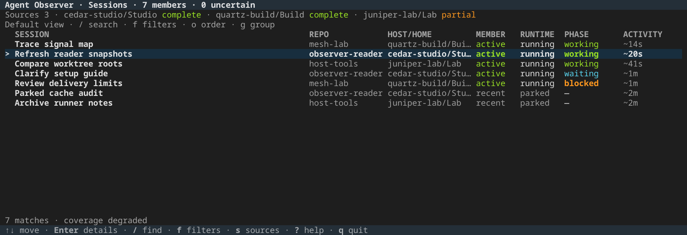
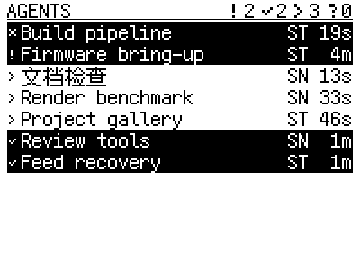

# Agent Observer

Keep your Codex sessions in view, locally and across machines. Run a quick check,
investigate an exact session, or keep the terminal dashboard open while you work.
Native Codex continues to own the conversations.

<!-- fleet-plus:terminal-dashboard -->


*Released a14 terminal application rendered from fictional cached sources.*

[Open the full-size dashboard](../../assets/observer-terminal-wide.png) ·
[See the compact layout](../../assets/observer-terminal-compact.png) ·
[Watch the terminal demo](../../assets/observer-terminal-demo.mp4) ·
[Media provenance](../../assets/provenance.json)
<!-- /fleet-plus:terminal-dashboard -->

## Check, investigate, keep watch

| Workflow | Command |
| --- | --- |
| Quick overview, up to ten rows | `agent-observer` |
| All matching sessions and full IDs | `agent-observer sessions list` |
| Search admitted session metadata | `agent-observer sessions list --query renderer` |
| Inspect one exact session | `agent-observer sessions show FULL_THREAD_ID --host HOST --home HOME` |
| Inspect the configured sources | `agent-observer sessions sources` |
| Versioned output for scripts | `agent-observer sessions list --format json` |
| Keep the dashboard open | `agent-observer dashboard` |

The quick overview answers a short check without leaving an application open.
The sessions commands expose full identities and qualified details. The optional
dashboard keeps a view open with search, filters, source health and exact-session
details; press `?` for keys and `q` to quit.

Dashboard search also covers current cached repository roots, shared Git
directories and relative paths. It uses admitted metadata; it does not inspect
your filesystem or search conversation content.

## Set up your sources once

Requires Linux and Python 3.11+. Follow the
[sessions CLI setup](https://github.com/byebyebryan/agent-observer/blob/main/docs/guides/sessions-cli.md)
for the published reader pair and private `terminal.toml`. The
[dashboard setup](https://github.com/byebyebryan/agent-observer/blob/main/docs/guides/dashboard.md)
adds optional dependencies and reuses the same configuration. Owner guides
retain the current hashes and installation pins.

**Existing working-set publishers/bridges are a prerequisite.** Check the
[working-set prerequisites](https://github.com/byebyebryan/agent-observer/blob/main/docs/guides/working-set.md#bounded-inspection)
and arrange source hosting before setting up a reader.
Use their exact host/home, source, namespace and route/socket in your terminal
configuration. The collector's Service 4 socket is a different endpoint.

Check configuration without connecting, then inspect actual source health:

```sh
agent-observer sessions sources --configured
agent-observer sessions sources
agent-observer
```

Installing or opening a reader starts no provider, collector or publisher. Remote
sources use existing directional routes. [Choose your setup](../start.md) for the
short path through these steps.

## Useful facts, with their limits intact

Membership, runtime and phase remain separate. Coverage and freshness stay
visible even with empty results or display filters. Missing or expired evidence
cannot prove idle work, an empty fleet or a removed conversation.

Working-set reads include admitted active membership and recent context; the
reviewed default window is 72 hours. They are a bounded projection rather than
the entire saved history. Delivery health cannot renew native evidence.

The [compatibility guide](../compatibility.md) separates the a14 terminal reader
from the a11 producers, independent consumers and their dated qualification.
The fictional preview adds no native-classification, sustained capacity, resource
or physical-device acceptance. The owner's [dashboard guide](https://github.com/byebyebryan/agent-observer/blob/main/docs/guides/dashboard.md#qualification-boundary)
records the measured boundaries.

## Follow an observation

<!-- fleet-plus:read-path -->
**Codex runtime → Agent Observer → optional Mesh → your utility.**

| Read path | What it does |
| --- | --- |
| Local cached read | A separately running Observer service supplies facts to your utility. Reading does not start a daemon or renew native evidence. |
| Optional fleet delivery | Mesh carries already published observations over configured routes, preserving host outcomes, identities and evidence expiry. |
| Partial or expired evidence | Incomplete or unavailable evidence stays explicit. A missing row cannot prove an empty working set, idle work or removal. |
<!-- /fleet-plus:read-path -->

The diagnostic core/local service remains independent of Mesh. Direct native
snapshots, cached Service 4, working-set reads and fuller diagnostic feeds retain
their separate uses. Start with the [first local read](https://github.com/byebyebryan/agent-observer/blob/main/docs/getting-started.md),
[local Service 4](https://github.com/byebyebryan/agent-observer/blob/main/docs/guides/local-service.md)
or [full Mesh reads](https://github.com/byebyebryan/agent-observer/blob/main/docs/guides/full-mesh-reads.md).

For your own utility, use the [bounded public-read example](https://github.com/byebyebryan/agent-observer/blob/main/docs/guides/read-utilities.md)
and [API 4 contract](https://github.com/byebyebryan/agent-observer/blob/main/docs/reference/read-api.md).
The reader supplies facts; your utility owns its presentation.

## A separate hardware consumer

The [RLCD agent dashboard](https://github.com/byebyebryan/esp32-rlcd/tree/main/projects/agent-dashboard)
turns public observations into a desk display. It owns row selection, the device
protocol and physical acceptance, with its own Observer/Mesh selection.

<!-- fleet-plus:dashboard -->


*Production C renderer with fictional conversations and virtual time; this is a UI
preview, not physical panel footage. [Watch the rendered demo](../../assets/dashboard.gif)
or read the [media provenance](../../assets/provenance.json).*
<!-- /fleet-plus:dashboard -->

## Current scope

Codex is the only implemented native observation adapter. Claude monitoring,
Observer writes and standalone active-only hosting are retired. Working-set
retains active membership; native provider tools own conversation control.

[Agent Plus](agent-plus.md) independently opens native Codex/Claude TUIs and
needs neither Observer nor Tmux. [Codex Plus](https://dev.byebyebryan.com/codex-plus/)
provides separate native workflow augmentations. Experimental transports retain
their own explicit selection and qualification.
