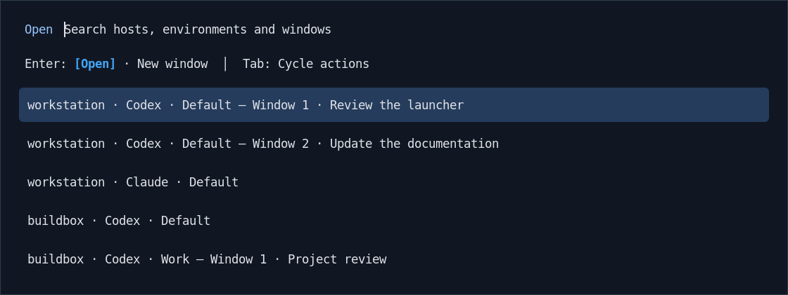

# Agent Plus

Find your Codex and Claude environments, then open or focus their native TUIs.
One searchable Rofi picker covers local environments and configured SSH hosts.

<!-- fleet-plus:agent-picker -->

*Actual Rofi rendering with sample data and a preview theme. No live sessions are
shown; your Rofi theme controls its appearance.*
<!-- /fleet-plus:agent-picker -->

## Native managers remain the daily interface

Agent Plus discovers environments and tracks its own dedicated windows. Open
focuses the exact selected registered window or enters its environment; New window
creates an independent native TUI client. Native Codex/Claude managers own the
conversations, work, settings and authentication inside those windows.

Inventory is about environments and window ownership. It is different from
Agent Observer's read-only conversation/runtime observations. Agent Plus needs
neither Agent Observer nor Tmux.

## Local and remote entry

SSH Plus supplies logical hosts and routes. A fixed Agent Plus host helper runs
on each remote provider host, so each TUI opens alongside its owning native runtime.
Removed peers are excluded from cached environment discovery and warnings;
an existing registered window does not grant access to a removed host.

## Start using it

The supported desktop is Linux with Niri and dedicated Kitty windows. Requires
Python 3.11+, Rofi 2.0+ and a provider CLI supporting `codex agents` or
`claude agents`. Remote use also needs OpenSSH, SSH Plus and the host helper on
the remote noninteractive PATH.

Follow the [getting-started guide](https://github.com/byebyebryan/rofi-agent-plus/blob/main/docs/getting-started.md),
[environment and remote configuration](https://github.com/byebyebryan/rofi-agent-plus/blob/main/docs/guides/configuration.md)
and [current architecture](https://github.com/byebyebryan/rofi-agent-plus/blob/main/docs/reference/architecture.md).
The Python package has no runtime Python dependencies.

## Supported scope

Agent Plus recognizes windows it launched. Arbitrary manually launched TUIs,
other terminal backends, Mosh and picker-driven Close remain outside the current
supported path. Claude native entry is supported independently of Observer's
retired Claude monitoring.

## Seven-day environment ordering

Each desktop keeps its own Agent Plus usage history. Each host, provider and
native-home combination has its own count; environments from all hosts are
ranked together. An accepted Open/New window launch or successful focus counts
once; discovery, filtering and work
inside a native TUI do not.

When any listed environment has a use in the rolling 168-hour window, higher
weekly counts sort first. Ties retain the existing Host Mesh, provider and
native-home order; numbered windows stay grouped inside their environment. If
all listed environments have zero weekly uses, retained last-use times supply
the recency fallback. The last window opened or focused through the picker is
highlighted separately from the ranked list. The native launcher freezes row scores for the dialog,
then captures current usage again when opened next time.

Usage history starts empty with a19; the existing last-selection hint is kept.
The owner [usage guide](https://github.com/byebyebryan/rofi-agent-plus/blob/main/docs/guides/usage.md)
and [managed operations guide](https://github.com/byebyebryan/rofi-agent-plus/blob/main/docs/maintenance/operations.md)
cover the state and installed-selection boundary.

The v0.15.0a19 release adds this ordering behavior. Source, package,
managed selection and native desktop appearance/input evidence remain separate;
see the [compatibility guide](../compatibility.md) and the owner's
[operations guide](https://github.com/byebyebryan/rofi-agent-plus/blob/main/docs/maintenance/operations.md).
